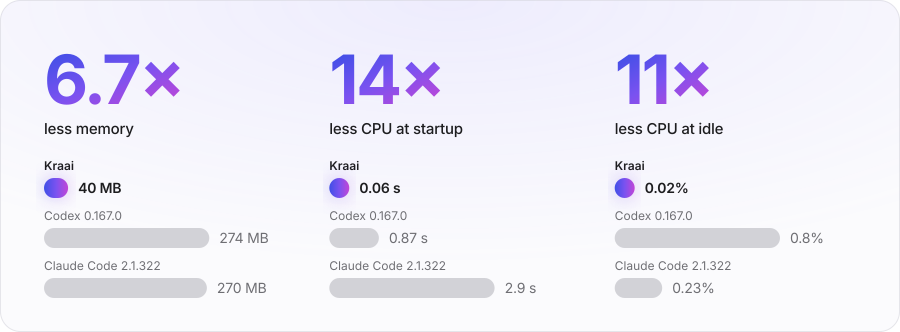
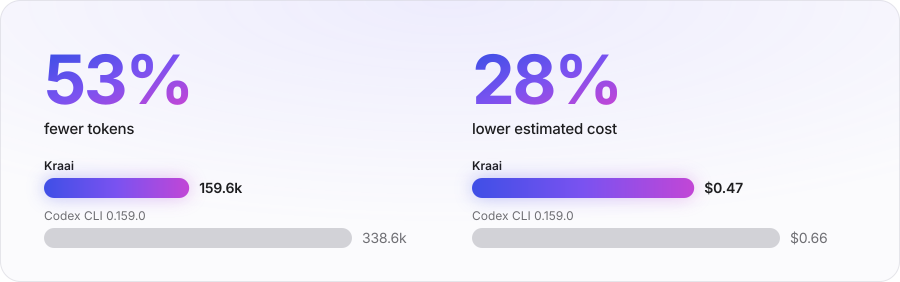
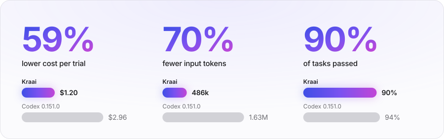

<p align="center">
  <picture>
    <source media="(prefers-color-scheme: dark)" srcset="assets/brand/svg/kraai-logo-white.svg">
    
  </picture>
</p>

Kraai is a lightweight, cost-efficient AI agent harness.

It gets there with a short system prompt, a few tools, and intentional context
management, not with tricks that make the model worse.

---

Current priorities, in order:

1. **Efficiency.** Big wins so far.
   - Nushell scripts. One script can search a repo, filter the matches, and
     edit a file, where other agents need several tool calls.
   - Open files. A file the model is working on stays in context as one copy
     that Kraai re-reads from disk, instead of a new snapshot after every edit.
2. **Features.** Catching up.
   - MCP servers, including OAuth sign-in.
   - Agent Client Protocol, so ACP editors can use Kraai as their agent.
   - Skills, web search, and image input.
3. **Safety.** Solid base.
   - Every script runs in a sandbox (Bubblewrap, Seatbelt, or AppContainer)
     and asks for the access it needs. Anything beyond the agent profile
     prompts you first.
4. **UX.** Barely started.
   - Open as many clients as you want at once, in terminals or ACP editors,
     on the same sessions. Every client follows the same live stream and
     approval prompts, whichever one is running the turn.

---

## CPU and memory

Each agent's terminal UI, started fresh in the same repo and left idle:

<!-- The chart numbers live in assets/readme/charts.py. Regenerate the charts with `python3 assets/readme/charts.py`. -->
<picture>
  <source media="(prefers-color-scheme: dark)" srcset="assets/readme/resources-dark.svg">
  
</picture>

Each number is the median of three runs on Linux in a 200×50 tmux pane, with
idle CPU measured over 60 seconds. Only each agent's own processes count, not
the MCP servers it starts. Each multiple compares Kraai with the closest other
agent.

---

## Coding tasks

Kraai and the Codex CLI on three of the in-house coding evals, both running
`gpt-5.6-sol` at low reasoning effort with a 16-request cap. Both passed every
hidden grader:

<picture>
  <source media="(prefers-color-scheme: dark)" srcset="assets/readme/coding-tasks-dark.svg">
  
</picture>

These are selected examples, not an average: each agent made one attempt per
task. Kraai cost 6% more on one of the three. Token totals include cached input,
and costs are API-equivalent estimates. The
[run notes](docs/benchmark-homepage-examples.md) and
[raw comparisons](docs/benchmark-evidence) have the per-task numbers.

---

## Terminal-Bench 4

Kraai and Codex on the same 20 Terminal-Bench 4 tasks, both running
`gpt-6-astra` at low reasoning effort:

<picture>
  <source media="(prefers-color-scheme: dark)" srcset="assets/readme/terminal-bench-dark.svg">
  
</picture>

These are the 20 tasks Codex finds easiest, so they say nothing about the hard
half of the benchmark. Codex passes 94% of them but only 51% of all 66.

Kraai ran each task twice and passed 36 of 40 trials. The Codex numbers are 94
of 100 trials from its [published leaderboard run](https://hub.harborframework.com/jobs/a538f69d-7756-444a-9dfe-43a0ab10b3a8),
filtered to the same tasks. Input tokens include cache reads. Cost is an
estimate at API prices ($10/M input, $1/M cached input, $50/M output).

---

## Run it

```sh
nix run github:kraai-io/kraai
```

Run it from the directory you want to work in. Add a provider with
`/providers`, pick a model with `/model`, and type a task. Typing `/` lists the
other commands.

---

## Development

```sh
nix develop
just run
```

Run `just check` before pushing.

### Evals

`kraai-eval` runs an agent on a benchmark and grades the result. The in-house
benchmark's tasks in `evals/tasks` are Git repos with hidden tests the agent
never sees. Terminal-Bench 4 runs through [Harbor](https://harborframework.com).
Every model request goes through a local proxy that records its tokens.
`kraai-eval` needs Linux, plus Docker for Terminal-Bench.

```sh
just eval run in-house --model gpt-6-astra --reasoning low --tasks 3 --attempts 5 --price-input 10 --price-output 50 --price-cache-read 1
just eval run terminal-bench --model gpt-6-astra --reasoning low --tasks 20
just eval check in-house
just eval-view
```

Results go to `~/.kraai/eval/<benchmark>/<model>-<reasoning>/<first run date>-<harness>-<binary sha256>/`.
Rerunning a command resumes it, and raising `--tasks` or `--attempts` only runs
the new attempts. A new harness binary starts a new folder.

### Performance

`kraai-perf` times fixed offline workloads, such as startup, streaming a reply,
and running a Nushell script, without calling a model. It reports wall time,
CPU time, and peak memory, so you can compare a change against a saved
baseline.

```sh
just perf run --output before.json
just perf compare before.json after.json
just profile cpu --workload streaming-response    # flame graph
```

---

## License

Apache-2.0
